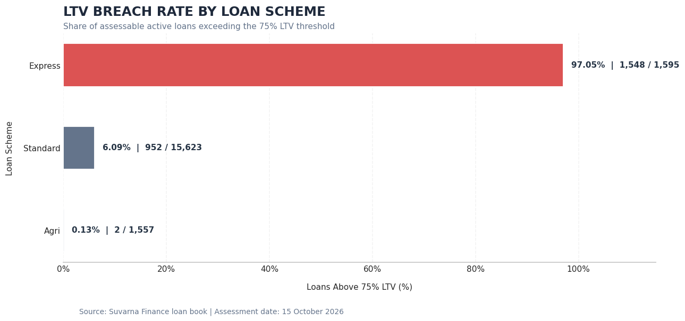
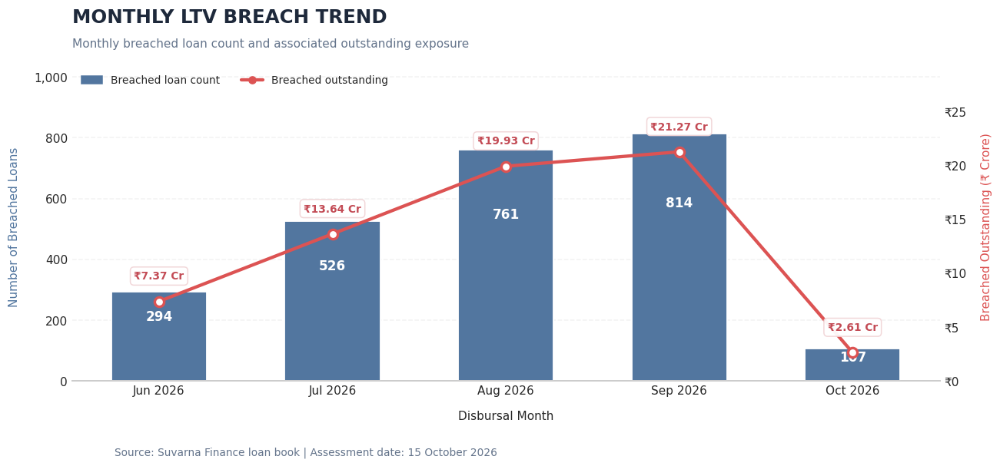
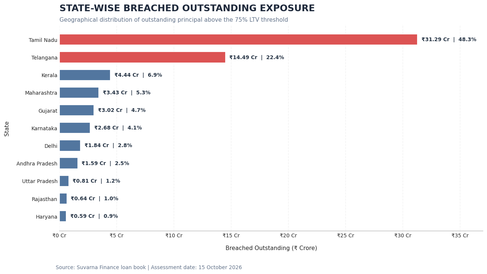
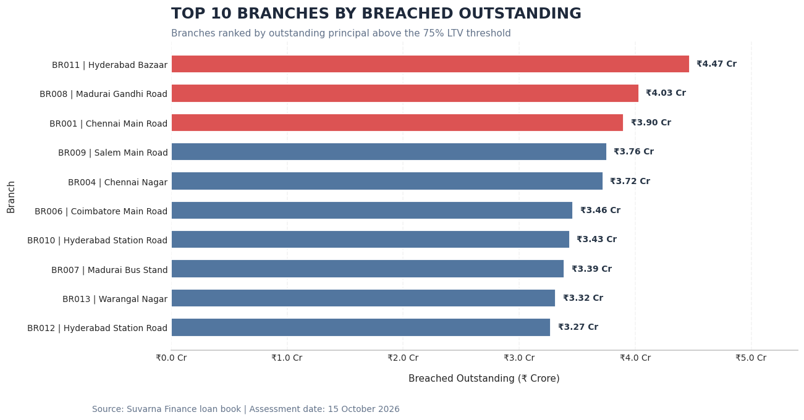

# Gold Loan LTV Breach Early Warning

**Banking & Finance** · SQL, Python (pandas, seaborn)

Gold prices have fallen sharply. Find which active gold loans now breach the regulatory LTV cap, how much money is at risk, and where.

> A live industry project on [JobPrax](https://www.jobprax.com). The client, Suvarna Finance Ltd, and its data are simulated.
> Certificate: [https://www.jobprax.com/certificates/DD-AVAE-C2BX](https://www.jobprax.com/certificates/DD-AVAE-C2BX)

## Business problem

Management does not know how many active gold loans currently breach the 75% LTV cap, how much outstanding principal is exposed, or which schemes, states and branches are driving the problem. The risk team needs a reliable, reproducible assessment as of 15 October 2026 to plan margin calls before the next risk committee.

## Objectives

- Measure the fall in the gold rate from its 2026 peak to the assessment date.
- Recalculate the current LTV of every active gold loan using the latest gold rate.
- Quantify the number of loans and the outstanding principal above the 75% cap, and above 80% (critical).
- Identify the schemes, disbursal periods, states and branches that contribute most to breaches.
- Recommend a prioritised margin-call plan and any change needed to lending policy.

## Executive summary

As of 15 October 2026, Suvarna Finance has 18,775 assessable active gold loans, of which 2,502 (13.33%) exceed the RBI's 75% LTV limit. These loans represent ₹64.81 crore in outstanding principal, including 564 critical loans above 80% LTV with ₹15.11 crore outstanding. Gold prices have fallen 10.22% from their 2026 peak, increasing portfolio risk. The Express scheme is the primary risk driver, with a 97.1% breach rate. Immediate priority should be to address critical accounts, initiate targeted recovery actions and tighten high-LTV lending controls.

## Key findings

The analysis identified 2,502 loans above the 75% LTV threshold, representing 13.33% of assessable active loans. The Express scheme is the largest risk contributor, with 1,548 breached loans out of 1,595 active loans (97.1%). Tamil Nadu and Telangana account for the highest breached outstanding exposure at ₹31.29 crore and ₹14.49 crore, respectively. September 2026 recorded the highest monthly breach count at 814 loans. The top 10 branches also show concentrated exposure, led by Hyderabad Bazaar with ₹4.47 crore. A further 5% decline in gold prices could increase the number of breached loans to 4,580. The four charts highlight scheme-wise, monthly, state-wise and branch-wise risk concentration.

## Recommendations

Prioritize the 564 critical loans above 80% LTV for immediate customer outreach and recovery action. Target the remaining breached accounts with a repayment requirement of approximately ₹2.59 crore to bring all breached loans down to 75% LTV. Review and tighten Express scheme lending limits, and prioritize monitoring in Tamil Nadu, Telangana and high-exposure branches. Introduce regular LTV monitoring against gold price movements to identify emerging breaches early.

## Charts









## What I did

- Solved 50 of 50 analysis tasks tied to the business requirements
- Wrote 16 SQL queries, one per task, in [`sql/`](sql)
- Explored and charted the data in Python, in [`notebook/analysis.ipynb`](notebook/analysis.ipynb)
- Wrote a final report with findings and recommendations, in [`report/report.md`](report/report.md)

## Skills

Data cleaning · Joins and aggregation · Business rules · Risk metrics · Executive reporting

## Data

- **Gold loans** (`gold_loans.csv`): One row per loan as extracted from the loan system. Contains duplicates and inconsistent formats.
- **Repayments** (`repayments.csv`): Every payment received. Interest payments do not reduce the principal.
- **Gold rates** (`gold_rates.csv`): Daily 24K gold rate used for valuation (no rates on Sundays and some holidays).
- **Branches** (`branches.csv`): Branch master data.
- **Customers** (`customers.csv`): Customer profile (no personal identifiers).

Column details and a sample of each table are in [`data/`](data).

## Repository structure

```
sql/          one SQL file per task
notebook/     Python analysis
report/       final report and charts
data/         table samples and column descriptions
```
