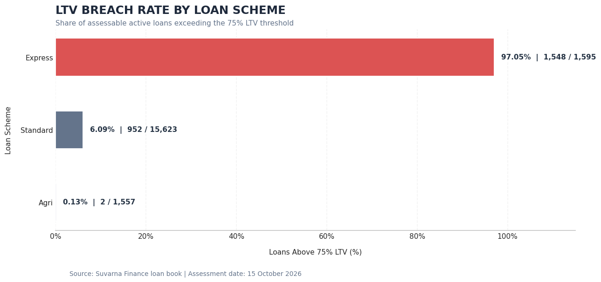
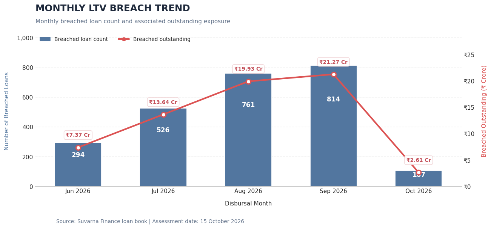
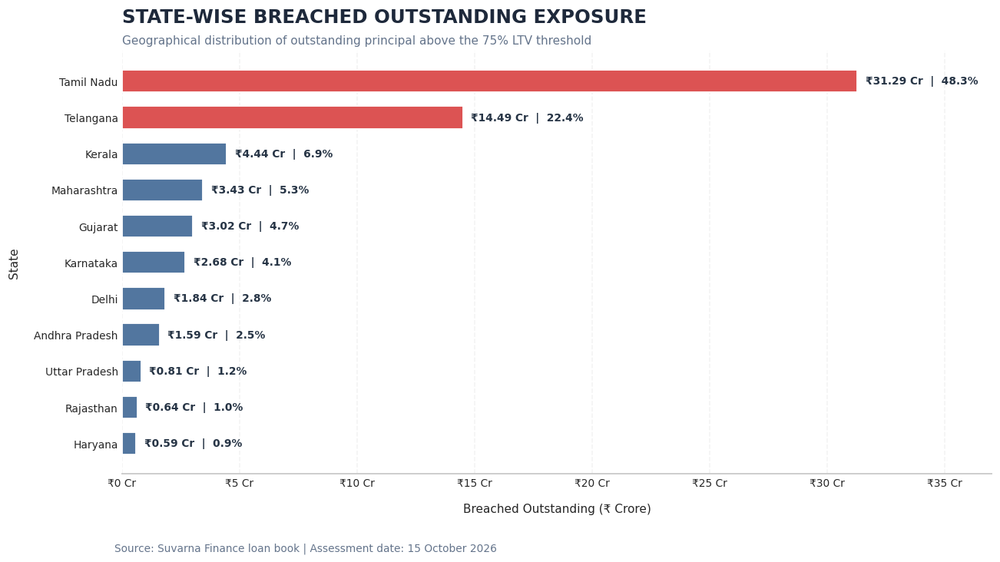
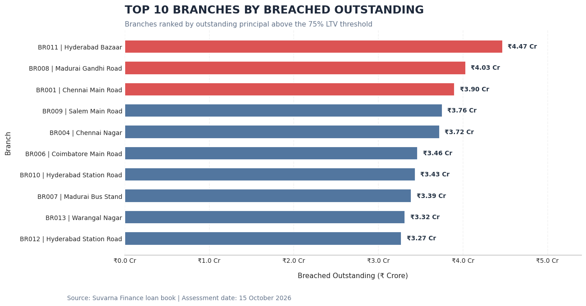

# Gold Loan LTV Breach Early Warning: final report

## Executive summary

As of 15 October 2026, Suvarna Finance has 18,775 assessable active gold loans, of which 2,502 (13.33%) exceed the RBI's 75% LTV limit. These loans represent ₹64.81 crore in outstanding principal, including 564 critical loans above 80% LTV with ₹15.11 crore outstanding. Gold prices have fallen 10.22% from their 2026 peak, increasing portfolio risk. The Express scheme is the primary risk driver, with a 97.1% breach rate. Immediate priority should be to address critical accounts, initiate targeted recovery actions and tighten high-LTV lending controls.

## Data quality

The raw loan dataset contained 24,280 rows, including 280 exact duplicate records, which were removed to obtain 24,000 unique loans. Nine variations in loan status values were standardized into three categories: active, closed and auctioned. Thirteen different purity formats were standardized into consistent karat values. Missing gold weight was identified in 110 records, and 6 records had non-positive principal values. After cleaning, 84 active loans were found to be unassessable due to missing gold weight or non-positive principal and were excluded from LTV calculations. These exclusions ensured that the risk assessment was based on valid and assessable active loans.

## Findings

The analysis identified 2,502 loans above the 75% LTV threshold, representing 13.33% of assessable active loans. The Express scheme is the largest risk contributor, with 1,548 breached loans out of 1,595 active loans (97.1%). Tamil Nadu and Telangana account for the highest breached outstanding exposure at ₹31.29 crore and ₹14.49 crore, respectively. September 2026 recorded the highest monthly breach count at 814 loans. The top 10 branches also show concentrated exposure, led by Hyderabad Bazaar with ₹4.47 crore. A further 5% decline in gold prices could increase the number of breached loans to 4,580. The four charts highlight scheme-wise, monthly, state-wise and branch-wise risk concentration.

## Recommendations

Prioritize the 564 critical loans above 80% LTV for immediate customer outreach and recovery action. Target the remaining breached accounts with a repayment requirement of approximately ₹2.59 crore to bring all breached loans down to 75% LTV. Review and tighten Express scheme lending limits, and prioritize monitoring in Tamil Nadu, Telangana and high-exposure branches. Introduce regular LTV monitoring against gold price movements to identify emerging breaches early.

## Charts

